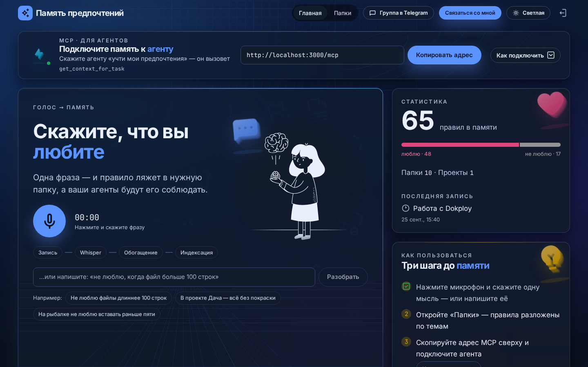
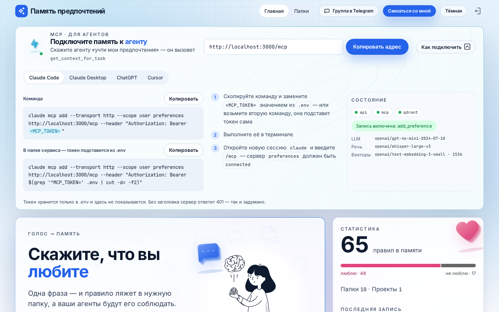
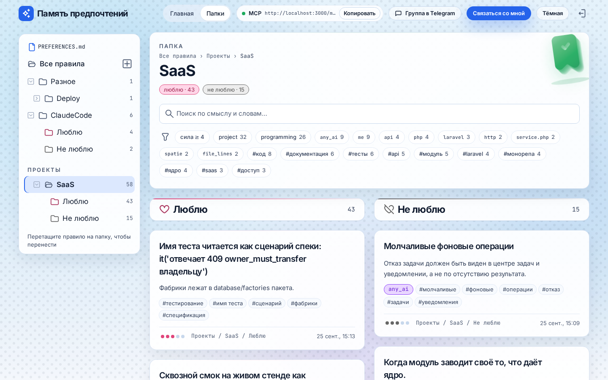
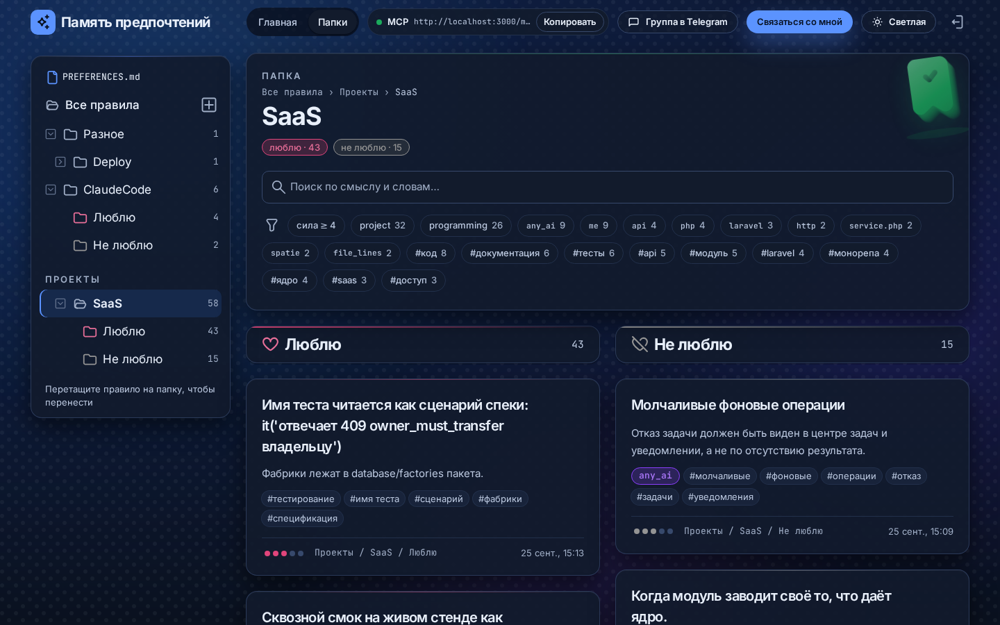
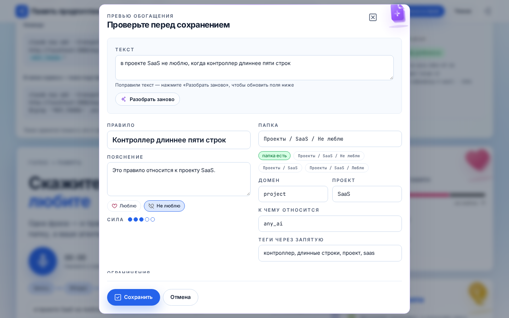
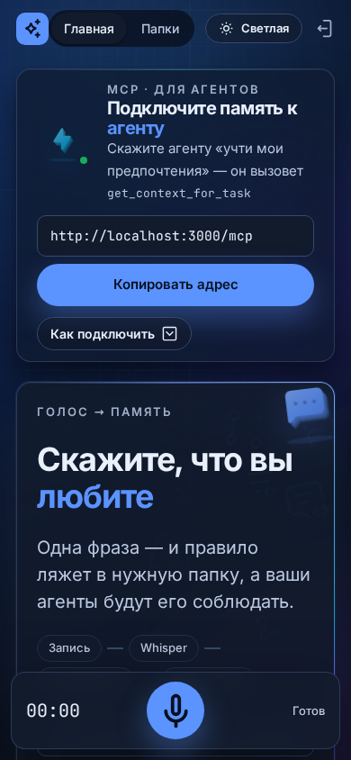

# Сервис моих предпочтений (preference-memory)

Личная память «люблю / не люблю» на любые темы: код, ИИ-ассистенты, рыбалка, путешествия, конкретные проекты.
Вы говорите фразу голосом или пишете текстом — сервис раскладывает её по папкам, сохраняет с уровнем правила
(«жёстко / по умолчанию / вкус») и собирает главный файл `PREFERENCES.md`. Агенты (Claude Code, Claude Desktop,
ChatGPT) читают правила через MCP-сервер.

## Демо

| Вход (email + пароль из `.env`) | Главная, светлая тема |
|---|---|
|  |  |
| **Главная, тёмная тема** | **Подключение агентов к MCP** |
|  |  |
| **Папки: проект SaaS** | **Папки, тёмная тема** |
|  |  |
| **Превью перед сохранением** | **Телефон** |
|  |  |

## Быстрый старт

1. Заполните `.env` (шаблон — `.env.example`). Обязательны четыре переменные: `OPENAI_API_KEY`, `MCP_TOKEN`
   (строка от 16 символов, например вывод `openssl rand -base64 32`), `ADMIN_EMAIL` и `ADMIN_PASSWORD` (от 8 символов).
2. Запустите:
   ```bash
   cp .env.example .env   # и заполните
   docker compose up -d --build
   ```
3. Откройте `http://localhost:3000` (или `PUBLIC_URL`).

Коллекции Qdrant и индексы создаются автоматически. Если обязательная переменная пуста, сервис не стартует и пишет в
лог, какую заполнить (`docker compose logs api`).

## Документация

| Файл | Что внутри |
|---|---|
| [docs/configuration.md](docs/configuration.md) | все переменные `.env` |
| [docs/connect.md](docs/connect.md) | подключение Claude Code, Claude Desktop, ChatGPT; навык; правила для проектов; решение проблем |
| [docs/how-it-works.md](docs/how-it-works.md) | конвейер сохранения, уровни правил, наследование, гигиена памяти |
| [docs/reference.md](docs/reference.md) | инструменты MCP, REST API, схема Qdrant |
| [docs/operations.md](docs/operations.md) | бэкапы, перенос данных, CI/CD и деплой |
| [docs/frontend.md](docs/frontend.md) | оформление интерфейса и анимации |
| [CHANGELOG.md](CHANGELOG.md) | история изменений |

## Архитектура

```
packages/core   env-схема (zod), OpenAI, Qdrant, обогащение, BM25, поиск, конфликты, папки, PREFERENCES.md
apps/api        Fastify, тонкий слой над core, volume data/
apps/mcp        FastMCP (поверх @modelcontextprotocol/sdk), httpStream, /mcp, /health
apps/web        React + Vite + TypeScript + Tailwind, nginx; прокси /api → api, /mcp → mcp
apps/backup     расписание бэкапов Qdrant (логика — packages/core/src/backup), volume backups/
```

Сервисы compose: `qdrant`, `api`, `mcp`, `backup`, `web`. Наружу опубликован только `WEB_PORT`.

## Разработка

```bash
npm install
npm test          # все workspaces; интеграционные тесты поднимают временный Qdrant (нужен Docker)
npm run lint      # ESLint + Prettier
npm run typecheck
```

OpenAI в тестах замокан; Qdrant — настоящий.

## Лицензия

[PolyForm Noncommercial 1.0.0](LICENSE). Исходный код открыт для просмотра, изучения и некоммерческого использования.
Коммерческое использование и продажа требуют письменного разрешения правообладателя. Юридически значим только
английский текст `LICENSE`.
