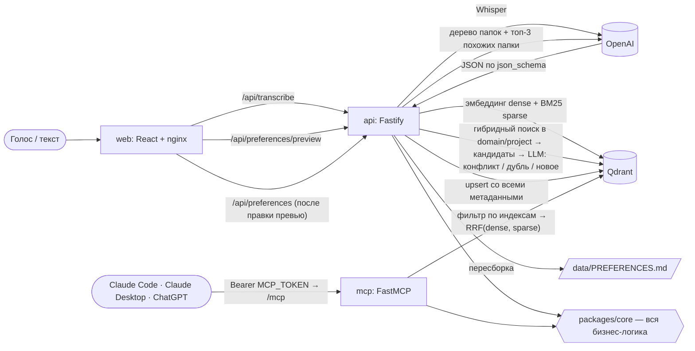

# Как это работает

Конвейер сохранения, уровни правил, наследование и гигиена памяти.

## Поток данных

1. Запись голоса → Whisper (`OPENAI_STT_MODEL`, `STT_LANGUAGE`) → текст можно поправить. Есть и текстовый ввод.
2. Обогащение (`OPENAI_LLM_MODEL`, строго JSON): statement, details, polarity, folder_path, domain, project,
   applies_to, tags, constraints, level, why, example_good, example_bad, language. Модель видит текущее дерево и топ-3 похожих папки из Qdrant,
   новую папку создаёт, только если ни одна не подходит. Модель извлекает условие буквально («больше 100 строк» →
   `file_lines > 100`), а требование выводит код: для «не люблю» оператор инвертируется (`file_lines <= 100`).
   Уровень модель берёт из слов («никогда», «всегда» → жёстко; «немного», «иногда» → вкус; иначе — по умолчанию),
   `why` и примеры — только если пользователь сам их сказал. `strength` выводится из уровня: 5 / 3 / 1.
   `applies_to` — к кому или чему относится правило, в любой сфере (claude_code, спиннинг, дети…). Ничего не
   зашито: модель видит метки, которые уже есть в памяти, и переиспользует их, новую заводит, только если ни одна
   не подходит. Метки, которых нет во фразе (сравнение с учётом транслита), отбрасываются — сервис не выдумывает
   данные; файлы и пути переезжают в теги, `me` и `any_ai` не хранятся. Опечатки: модель правит орфографию текста
   по названиям пользователя, а новая папка, тег или метка, отличающиеся от существующих на 1–2 буквы,
   приклеиваются к ним («Деплои и CI» → «Деплой и CI»). Подсказка Whisper собирается из папок, проектов и меток.
3. Эмбеддинги: dense (`OPENAI_EMBED_MODEL`, `EMBED_DIM`, cosine) по statement + details + why + folder_path + tags;
   sparse BM25 считается в core (токенизация со стеммингом Snowball для русского и английского, `modifier: idf`).
4. Конфликт/дубль: гибридный поиск (RRF) с фильтром по domain (и project) → кандидаты со сходством ≥
   `CONFLICT_SCORE` (максимум из косинуса векторов и косинуса исходных фраз — противоположные правила лежат в разных
   папках «Люблю»/«Не люблю», и их векторы расходятся) → топ-5 → LLM решает: **противоречит** (правило обновляется,
   прежняя версия уходит в `history[]`, при смене полярности — перенос в соседнюю папку), **дублирует** (обновляются
   `updated_at`, уровень становится строже из двух, пустые «почему» и примеры дополняются) или **новое**.
5. Upsert в Qdrant и пересборка `PREFERENCES.md` (volume `data`, `GET /api/export.md`, `?folder=<путь>` — ветка).

**Параллельная запись.** Превью, эмбеддинги и LLM-обогащение выполняются вне замка записи, поэтому пакетное обучение
идёт параллельно. Под замком остаются только поиск конфликта, решение LLM по конфликту, создание папок и upsert.
Пересчёт счётчиков папок и пересборка `PREFERENCES.md` объединяются (`CoalescedRefresh`): одновременно идёт одно
обновление и не более одного хвостового; ошибка повторяется один раз, затем пишется в лог, а запись не падает.
При остановке `api` и `mcp` вызывается `PreferenceService.drain()`: он дожидается записей, уже вошедших в замок, и
последнего обновления. Запрос, который ещё готовится вне замка, не ждётся; хранилище он не трогал, частичной записи
не остаётся. Тесты core идут по одному файлу (`fileParallelism: false` в `packages/core/vitest.config.ts`): все
файлы используют один Qdrant-контейнер, и параллельный запуск выбивает интеграционные тесты за `testTimeout`.

## Уровни правил, «почему» и «так / не так»

| Уровень | Что делает агент |
|---|---|
| **жёстко** (`hard`) | соблюдает всегда; нарушение — дефект, как у ограничения `constraints` |
| **по умолчанию** (`default`) | соблюдает; отступить может, только назвав причину |
| **вкус** (`taste`) | учитывает, если нет причин поступить иначе |

`get_context_for_task` всегда отдаёт все правила уровня «жёстко» из доменов задачи, даже если они не попали в
top_k. У правила может быть **«почему»** (причина со слов пользователя — по ней агент решает пограничные случаи) и
пример **«так» / «не так»**. Всё это видно на карточке, редактируется в превью и в редакторе, передаётся в MCP
`add_preference` (`level`, `why`, `example_good`, `example_bad`). Правила, сохранённые до появления уровней,
переводятся автоматически при старте api: с ограничениями или силой 5 → «жёстко», сила 1–2 → «вкус», остальные →
«по умолчанию».

## Наследование: общее → проект

Работает одинаково для любой сферы и ничего не знает о предметах заранее — всё выводится из ваших данных.
Когда в задаче назван проект, `get_context_for_task` отдаёт целиком, без ранжирования и обрезки `top_k`, все
правила проекта и **все общие правила, которые он наследует**:

- **метки** — `applies_to` правил проекта и метки, названные в задаче («Дача: взять фидер» добавит `фидер`);
- **темы** — папки (без «Люблю»/«Не люблю») общих правил с этими метками или папки, названные как метка
  («Рыбалка/Снасти», «Laravel»);
- **области** — `domain` задачи, проекта и подошедших правил.

Общее правило входит, если у него есть метка проекта, оно лежит в теме проекта или у него нет меток, а его
область — область проекта. Правила других проектов и общие правила с чужими метками (фидер в проекте про
спиннинг, Next в проекте на Laravel) в ранжирование для этой задачи не попадают; жёсткие правила приходят всегда.

## Гигиена памяти

- **Дубли.** На главной в «Статистике» — «Найти дубли». Сервис сравнивает формулировки всех правил (эмбеддинги,
  порог `DUPLICATE_SCORE`), собирает группы похожих, а модель подтверждает, какие из них требуют одного и того же
  (в том числе «люблю X» и «не люблю не-X»). По каждой группе: выбрать, какое правило оставить (предложено
  строже и полнее), и «Слить» — теги, цели и ограничения объединяются, уровень берётся строже, пустые «почему» и
  примеры дополняются, слитые правила сохраняются в истории. «Не дубли» — группа запоминается (`distinct_from`) и
  больше не предлагается.
- **Распределить.** Там же — «Распределить»: каждое общее правило (вне проектов) заново проходит выбор папки и
  области тем же конвейером, что при сохранении. Окно показывает, что куда переедет, и смену области; переносятся
  отмеченные, папки, опустевшие после переноса, удаляются. Правила проектов не трогаются. То же — инструмент MCP
  `redistribute_rules` (сначала план, с `apply: true` — перенос).
- **Метки `applies_to`** — см. «Поток данных»; при старте api файлы и пути из старых меток переезжают в теги.
- **Опечатки** исправляются при превью: орфография текста — моделью, имена папок и тегов — по существующим.
